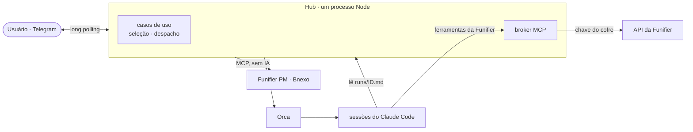

# Arquitetura: como o código está hoje

Como o hub funciona por dentro, na branch `v2` (05/11/2026). Siglas na [legenda](README.md#legenda).

## 1. A ideia em uma tela



**O hub não usa IA.** É um orquestrador: lê as tasks nas ferramentas de gestão, conversa por botões, escreve o
prompt num arquivo, digita **uma linha** no terminal do Claude Code pelo Orca e lê a tela até aparecer o bloco
`### RESULTADO HUB`. A IA está só nas sessões do Claude.

## 2. Hexagonal em 4 frases

1. **Domínio** (`src/dominio/`): regras puras. Não importa nada de fora (nem banco, nem Telegram, nem Orca).
2. **Portas** (`src/aplicacao/portas.ts`): interfaces do que o hub precisa do mundo de fora ("mande uma mensagem",
   "abra um terminal", "guarde esta seleção"), sem dizer quem faz.
3. **Casos de uso** (`src/aplicacao/`): o que o hub faz (despachar, monitorar…). Usam só domínio e portas.
4. **Adaptadores** (`src/adaptadores/`): quem faz de verdade (SQLite, Telegram, Orca, Keychain). **`src/main.ts`**
   é o único lugar que escolhe os adaptadores e liga tudo.

**Regra:** as dependências só apontam para dentro: `adaptadores → aplicacao → dominio`. Por isso os testes trocam
o Telegram e o Orca por versões falsas (`tests/fakes.ts`) e rodam o ciclo inteiro em menos de um segundo.

**O que ganhamos:** trocar Telegram por Teams, Orca por tmux ou SQLite por Prisma mexe só no adaptador e no `main.ts`.

## 3. Cada pasta e arquivo

### Domínio: regras puras

| Arquivo | Responsabilidade |
|---|---|
| `dominio/despacho.ts` | Estados do despacho e transições permitidas; tag da rodada (`#12.2`); validação de nome de branch |
| `dominio/selecao.ts` | Estados da seleção; em cada etapa da conversa, quais botões ainda valem |
| `dominio/tela.ts` | Lê a tela do Claude: `classificarTela` (ocioso, ocupado, aguardando, limite) e `extrairResultado` |
| `dominio/broker.ts` | Política do broker: o que a sessão pode chamar na Funifier, e o que pede confirmação |

### Aplicação: portas e casos de uso

| Arquivo | Responsabilidade |
|---|---|
| `aplicacao/portas.ts` | As interfaces: `Executor`, `Notificador` (+ `Teclado`), `Cofre`, `Confirmador`, `RepositorioSelecoes`, `RepositorioDespachos`, `RepositorioResumos`, `Memoria`, `GitProjetos`, `CatalogoApps` |
| **selecao/** | *Da lista de tasks até "pronta para despachar"* |
| `selecao/resumo-diario.ts` | Manda a lista de tasks com ⬜/✅; Iniciar, Em lote, Nenhuma |
| `selecao/configurar.ts` | A conversa por task: info extra → destino → gamificações → confirmar; `/nova` (avulsa) |
| `selecao/ambiente.ts` | Task de projeto sem app: liga a um app ou cria pasta/clone + Orca + `apps.yaml` |
| `selecao/contexto.ts` | O que esses casos recebem (`DepsSelecao`) e o apoio comum da conversa (`Conversa`) |
| `selecao/index.ts` | Monta os casos de uso da seleção |
| **despacho/** | *Da fila até o Encerrar* |
| `despacho/despachar.ts` | Fila por app (uma task por vez), escreve o prompt e envia a linha ao terminal |
| `despacho/sessoes.ts` | Acha uma sessão ociosa na pasta do app ou abre uma (`claude -c` / `--resume`) |
| `despacho/monitorar.ts` | Acompanha a sessão até o resultado; avisa "precisa de você", limite de uso, terminal sumido |
| `despacho/proximos-passos.ts` | Botões depois da conclusão: 💬 instrução, 🔀 PR, ✅ encerrar (e status no PM) |
| `despacho/contexto.ts` | `DepsDespacho` e o apoio comum (`Tasks`: título, link, mover status) |
| `despacho/index.ts` | Monta os casos de uso e liga um ao outro (`aoLiberar`, `aoPedirSeguimento`) |

### Adaptadores: o mundo de fora

| Arquivo | Implementa | Como |
|---|---|---|
| `adaptadores/persistencia/sqlite.ts` | os repositórios e a `Memoria` | **Todo o SQL** de seleções, despachos e resumos |
| `adaptadores/chat/telegram.ts` | `Notificador` | HTML + botões (`InlineKeyboard`); download de anexos |
| `adaptadores/executor/orca.ts` | `Executor` | CLI do Orca com `execFile` e `--json` |
| `adaptadores/cofre/keychain.ts` | `Cofre` (Mac) | Keychain do macOS |
| `adaptadores/cofre/arquivo-cifrado.ts` | `Cofre` (servidor) | AES-256-GCM, chave do `systemd-creds` |
| `adaptadores/cofre/memoria.ts` | `Cofre` (testes) | Em memória |
| `adaptadores/funifier/conexoes.ts` | — | Um `funifier-mcp` filho por credencial, para o broker |
| `pm/funifier-pm.ts`, `pm/bnexo.ts` | `PmAdapter` | Tools MCP de cada ferramenta → modelo do hub ([referência](referencia/mcp-ferramentas-de-gestao.md)) |
| `pm/mcp-client.ts`, `pm/types.ts` | — | Conexão MCP (OAuth do PM, Bearer do Bnexo); contrato `PmAdapter` e `Task` |

### Ainda fora das camadas (a migrar, ver [plano](plano.md))

Funcionam, mas falam direto com o Telegram ou o banco:

| Arquivo | Responsabilidade |
|---|---|
| `main.ts` | Raiz de composição: cria adaptadores e casos de uso, timers (despacho 30 s, resumo, limpeza 04:00), "Hub online" |
| `telegram.ts` | Filtro do chat, comandos (`/tarefas`, `/nova`…), roteador de botões e de texto livre |
| `gamificacoes.ts` | `/gamificacoes`: cadastro de gamificação e credenciais (apaga a mensagem com a chave) |
| `regras.ts` | `/regras`: ver e editar `regras/<empresa>.md` |
| `projetos.ts` | `/projetos`: liga e desliga projetos da listagem |
| `login-pm.ts` | `/pm_login`: login do Funifier PM pelo celular |
| `confirmacao.ts` | Permitir/Negar no Telegram para chamadas do broker |
| `broker/broker.ts` | Servidor MCP em 127.0.0.1 que a sessão usa para falar com a Funifier ([segurança](seguranca.md)) |
| `resumo.ts` | Busca as tasks em todas as ferramentas e monta o texto da lista |
| `prompt.ts` | Escreve `runs/<id>.md` (task, lote, rodadas) e o bloco de encerramento |
| `segredos.ts` | Credenciais da task (cópia por task no Mac; migração do cofre antigo) |
| `limpeza.ts` | Apaga `runs/` antigos (30 dias, ou `/limpar_runs`) |
| `mensagens.ts` | Registra cada mensagem para o `/limpar` |
| `msg.ts` | Padrão visual dos cartões (ícone, título, contexto, corpo, rodapé) |
| `config.ts`, `caminhos.ts` | `.env` e `apps.yaml` validados (zod); onde ficam dados, runs e repositórios |
| `db.ts` | Abre o SQLite e roda as migrações |
| `git.ts` | Git do hub (no servidor, como o usuário `agente`) e a porta `GitProjetos` |
| `logger.ts` | Logs JSON por dia, sem segredos |

Fora de `src/`: `scripts/` (testes manuais e login), `deploy/` (VM e deploy, ver [servidor](servidor.md)),
`tests/` (Vitest: `dominio/` puros, `unit/` com dublês), `apps.yaml` e `regras/*.md` (lidos em execução).

## 4. Ciclo de uma task

```mermaid
sequenceDiagram
  autonumber
  participant U as Usuário
  participant S as seleção
  participant D as despacho
  participant P as PM
  participant O as Orca/Claude
  S->>P: lista as tasks (cron ou /tarefas)
  S->>U: lista com ⬜/✅
  U->>S: marca e toca Iniciar
  S->>U: perguntas (info, destino, gamificações, confirmar)
  U->>S: ▶️ Despachar
  S->>D: enfileirar
  D->>O: acha ou abre sessão; escreve runs/ID.md; envia 1 linha
  D->>P: status "em progresso"
  loop monitor
    D->>O: lê a tela
    D-->>U: 🙋 precisa de você / ⏸️ limite (se for o caso)
  end
  O-->>D: ### RESULTADO HUB (task: #ID.rodada)
  D->>U: ✅ resultado + 💬 instrução · 🔀 PR · ✅ encerrar
  U->>D: ✅ Encerrar → "concluir no PM?"
```

**Protocolo hub ↔ sessão:**
- **Ida:** o prompt completo fica em `runs/<id>.md` (rodadas seguintes: `runs/<id>-<n>.md`). Ao terminal vai uma
  linha só, o que evita quebra de linha e injeção no shell.
- **Volta:** o prompt exige terminar com `### RESULTADO HUB` (task, status, resumo, arquivos, branch, pendências).
  O hub só aceita o bloco cuja `task:` bate com a rodada atual.
- **Lote:** a primeira task é a líder; as outras têm `lote_de = líder` e seguem o estado dela.

## 5. Estados

| Máquina | Estados |
|---|---|
| Seleção | `coletando` → `aguardando_despacho` → `despachada` → `finalizada` → `encerrada` (ou `cancelada`, `interrompida`) |
| Etapa da conversa (dentro de `coletando`) | `instrucoes` → `info` → `empresa` → `destino` → (`ambiente`, `amb_*`, `escolher_app`) → `alvo` → `confirmar` |
| Despacho | `em_execucao` ⇄ `aguardando_usuario` / `pausado_limite` → `concluido` → `seguimento_fila` (nova rodada) ou `encerrado`; `interrompido` após 3 falhas de achar o terminal |

Tudo fica no banco, então reiniciar o hub no meio de uma conversa ou de um despacho não perde nada.

## 6. Banco (SQLite)

| Tabela | Guarda |
|---|---|
| `tasks_vistas` | Tasks vistas nas ferramentas (título, projeto, prazo, link) |
| `resumos`, `resumo_itens` | Cada lista enviada e o que foi marcado |
| `selecoes` | Uma task em configuração ou em andamento (etapa, app, gamificações, lote) |
| `fila` | Tasks esperando o app ficar livre |
| `despachos` | Cada envio a uma sessão (terminal, rodada, resultado) |
| `historico` | Uma linha por task encerrada |
| `projetos` | Projetos ligados ou desligados no `/projetos` |
| `mensagens` | Ids das mensagens, para o `/limpar` |
| `meta` | Chave-valor: data do último resumo, conversas abertas (`pos_conversa`, `regras_conversa`…) |

Migrações em `db.ts`, numeradas por `PRAGMA user_version`; nunca se edita uma antiga, só se acrescenta.

## 7. Telegram: botões e texto

Cada botão carrega um texto curto (até 64 bytes) `tipo:id:ação`:

| Tipo | Dono | Uso |
|---|---|---|
| `t`, `r` | resumo-diario | marcar task; Iniciar / Em lote / Nenhuma |
| `s` | configurar | respostas da conversa |
| `f` | proximos-passos | instrução, PR, encerrar |
| `g`, `m`, `p` | regras, gamificacoes, projetos | os comandos de configuração |
| `k` | confirmacao | Permitir/Negar do broker |
| `l`, `u` | telegram | `/limpar`, `/limpar_runs` |

Botão de mensagem antiga responde "já foi respondida". Texto livre passa pelos módulos com conversa aberta, nesta
ordem: login do PM → gamificações → regras → próximos passos → configurar.

## 8. Segurança no código

- Só o `TELEGRAM_CHAT_ID` do usuário é atendido; o resto é descartado e registrado.
- Orca sempre por `execFile` com argumentos em array; o texto da task nunca vira comando.
- Sessões com `--permission-mode auto`; `bypassPermissions` é recusado na validação.
- Status no PM: "em progresso" ao despachar, "concluída" só com Sim no Encerrar; comentários bloqueados.
- Logs com tokens e chaves mascarados. Credenciais: ver [segurança](seguranca.md).

## 9. Limites conhecidos

- A leitura da tela depende do texto do Claude Code (`esc to interrupt`, `❯`): uma versão nova pode exigir ajuste
  em `dominio/tela.ts` (I2).
- Os casos de uso ainda montam o HTML das mensagens; falta o Presenter, que só compensa com um segundo chat (Teams).
- Os botões ainda são texto solto (`f:12:pr`); falta um formato tipado.
