# Arquitetura e código — Hub v1

Como o hub funciona por dentro: stack, camadas, responsabilidade de cada arquivo, como as partes se comunicam (Telegram, ferramentas de gestão, Orca, Claude Code), o banco e os protocolos internos. Os diagramas são Mermaid: aparecem desenhados no GitHub e no preview de Markdown do VS Code/Orca.

Leitura rápida: seções 1, 2 e 3. Detalhes: a partir da 4.

---

## 1. Visão em uma tela

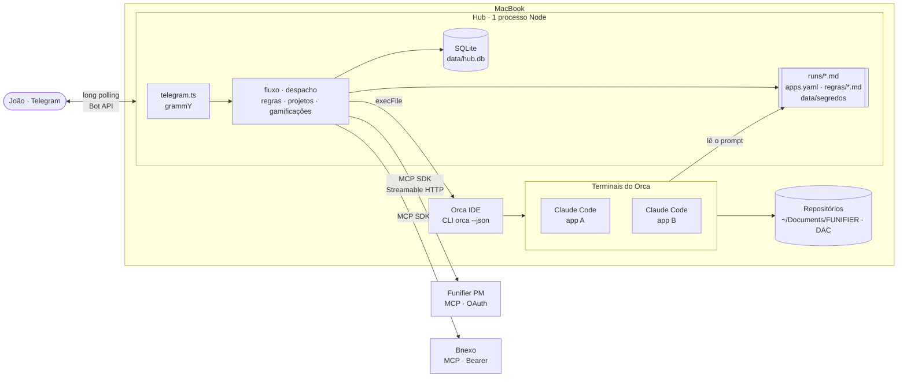

**A ideia central:** o hub **não usa IA**. É um orquestrador determinístico:
- lê as tasks nas ferramentas de gestão (MCP chamado direto pelo código);
- conversa com o João por botões;
- escreve um prompt em arquivo;
- digita **uma linha** no terminal do Claude Code via Orca;
- acompanha a execução **lendo a tela** até aparecer o bloco `RESULTADO HUB`.

A IA está só nas sessões do Claude Code.

---

## 2. Stack

| Peça | O quê | Por quê |
|---|---|---|
| Runtime | Node 22, ESM (`"type": "module"`), top-level await | Um processo, um event loop. |
| Linguagem | TypeScript 7 strict, executado com **tsx** (sem build; `tsc --noEmit` só checa tipos) | Ciclo rápido; a Fase 7 decide se compila para `dist/`. |
| Framework | **Nenhum framework web/app.** Bibliotecas pontuais. | O hub não serve HTTP; é um bot + laços. |
| Telegram | **grammY** (long polling, middlewares, `InlineKeyboard`, transformer da API) | Sem porta aberta nem domínio. |
| Banco | **SQLite** via **better-sqlite3** (síncrono), WAL, `foreign_keys=ON` | Arquivo único, transações síncronas simples, zero infraestrutura. |
| Ferramentas de gestão | **@modelcontextprotocol/sdk** (cliente MCP, Streamable HTTP, OAuth 2.1 + PKCE) | Chama as tools dos MCPs direto, sem LLM. |
| Validação | **zod** (`.env` e `apps.yaml`) | Falha cedo e com mensagem clara. |
| Config | **yaml** (`parseDocument` para editar preservando comentários) | O bot edita o `apps.yaml` sem destruir a formatação. |
| Agendamento | **node-cron** (com `timezone` e `noOverlap`) + `setInterval` | Resumo diário, limpeza, laço do despachante. |
| Orca | CLI `orca … --json` via `child_process.execFile` | Sem shell: o texto das tasks nunca vira comando. |

---

## 3. Mapa dos arquivos

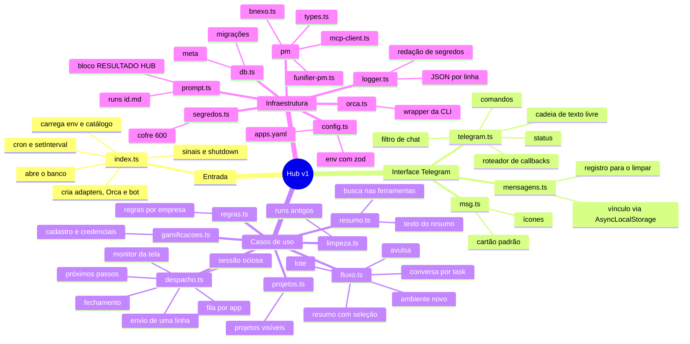

### Responsabilidades, arquivo a arquivo

| Arquivo | Linhas* | Responsabilidade | Estado que mantém |
|---|---|---|---|
| `index.ts` | 50 | Composition root: monta tudo e liga os timers (despacho 30 s, resumo diário + catch-up 5 min, limpeza 04:00). | — |
| `telegram.ts` | 245 | `createBot()`: filtro de chat, comandos, roteador de `callback_query` por prefixo, cadeia de texto livre, `/status`. Faz a injeção de dependências entre os módulos. | — |
| `mensagens.ts` | 80 | Vínculo de cada mensagem a uma seleção ou resumo (AsyncLocalStorage); `/limpar` apaga a faixa de ids. | tabela `mensagens` |
| `msg.ts` | 55 | Padrão visual: `cartao({icone,titulo,contexto,corpo,rodape})`, `campo`, `esc`, `curto`, `ICONE`. | — |
| `fluxo.ts` | ~800 | Resumo com ⬜/✅, Iniciar/Lote/Nenhuma, máquina de etapas da conversa (info → destino → alvo → confirmar), `/nova`, ambiente novo (clone, `orca repo add`, `apps.yaml`). | `resumos`, `resumo_itens`, `selecoes` |
| `despacho.ts` | ~1100 | `Despachante`: fila por app, achar ou abrir sessão, escrever o prompt, enviar, monitorar a tela, fechar, botões de próximos passos (instrução, PR, encerrar), status na ferramenta. | `fila`, `despachos`, `historico`, `meta.pos_conversa` |
| `resumo.ts` | 130 | `buscarTasks` (todos os adapters em paralelo), `registrarVistas`, `montarResumo` (agrupado por empresa e categoria). | `tasks_vistas` |
| `projetos.ts` | 95 | Registra projetos vistos; `/projetos` liga e desliga; filtra o resumo. | `projetos` |
| `regras.ts` | 175 | `regras/<empresa>.md`: mostra em texto simples, recebe o novo texto, reformata em Markdown, guarda histórico. | `meta.regras_conversa` |
| `gamificacoes.ts` | 220 | `/gamificacoes`: cadastro guiado (nome → servidor → conta → key → secret), apaga as mensagens com credenciais. | `meta.gamif_conversa` |
| `limpeza.ts` | 85 | Apaga prompts e anexos de `runs/` (automático, mais de 30 dias; manual pelo `/limpar_runs`), nunca `credenciais.json` nem task em andamento. | — |
| `config.ts` | 160 | `loadEnv` e `loadCatalogo` (zod; relido a cada uso, então edições valem sem restart); helpers que editam o `apps.yaml` com backup. | `apps.yaml` |
| `db.ts` | 210 | `openDb`, migrações versionadas por `PRAGMA user_version`, `getMeta`/`setMeta`, `contagens`. | `data/hub.db` |
| `prompt.ts` | 230 | `escreverPrompt` (task ou lote), `escreverSeguimento` (rodada N), download de imagens, bloco de encerramento, `tagRodada`. | `runs/` |
| `orca.ts` | 135 | Wrapper tipado da CLI: `status`, `listRepos`, `listTerminals`, `agentStates`, `readScreen`, `send`, `waitIdle`, `createTerminal`, `addRepo`, `setWorktreeStatus`. | — |
| `segredos.ts` | 60 | Cofre `data/segredos/gamificacoes.json` (600) e cópia por task `runs/<id>/credenciais.json`. | cofre |
| `logger.ts` | 55 | `logs/hub-AAAA-MM-DD.log` (JSON por linha), redação de tokens. | `logs/` |
| `pm/types.ts` | 150 | Contrato `PmAdapter`, `Task`/`TaskDetalhe`, `McpConexao` (conexão preguiçosa e uma reconexão), travas de escrita, utilitários HTML e prazo. | — |
| `pm/mcp-client.ts` | 150 | `connect()`: Bnexo com Bearer; Funifier PM com OAuth (provider em arquivo, callback em `localhost:53682`). | `data/oauth/` |
| `pm/funifier-pm.ts` / `pm/bnexo.ts` | ~120 cada | Traduzem tools e status de cada ferramenta para o modelo do hub. | — |

\* aproximado. `scripts/` tem utilitários de linha de comando: `mcp-explore.ts`, que também faz o login OAuth (`npm run pm:login`), `mcp-call.ts` e `despacho-teste.ts`, que põe uma task fictícia na fila do sandbox.

---

## 4. Camadas e dependências

O projeto é organizado **por responsabilidade, em camadas**, sem framework de injeção: `index.ts` instancia e `telegram.ts` liga os módulos por callbacks (`fluxo.onDespachar`, `gamificacoes.onConcluido`). As classes recebem `db`, `api` (grammY) e `env` no construtor.

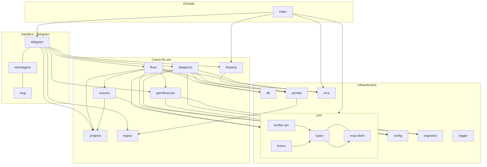

Pontos de acoplamento que vale conhecer:
- `fluxo` e `despacho` são os dois módulos grandes e **não se importam**: o vínculo é a tabela `fila` e o callback `onDespachar`.
- `msg.ts` usa `escapeHtml` de `resumo.ts`, e `segredos.ts` usa `dirAnexos` de `prompt.ts`. São utilitários em lugar mais pessoal do que deveriam; a v2 deve movê-los para um `util`.
- Os adapters de PM são as únicas implementações de uma **interface** (`PmAdapter`). O Orca é uma classe concreta, e a v2 prevê extrair a interface `Executor`.

---

## 5. Integrações

### 5.1 Telegram (grammY, long polling)

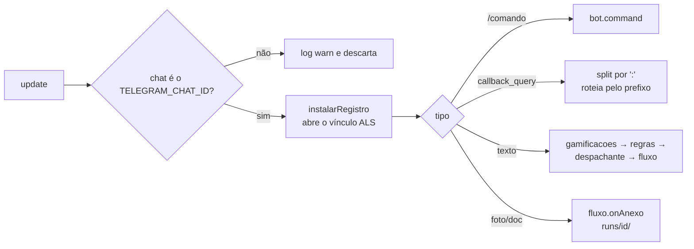

**Protocolo de `callback_data`** (máximo de 64 bytes, por isso ids curtos):

| Prefixo | Dono | Formato | Uso |
|---|---|---|---|
| `t` | fluxo | `t:<resumo>:<idx>` | alterna ⬜/✅ de uma task do resumo |
| `r` | fluxo | `r:<resumo>:go\|lote\|none` | Iniciar / Em lote / Nenhuma |
| `s` | fluxo | `s:<selecao>:<acao>[:arg]` | respostas da conversa (`pular`, `ok`, `app:<nome>`, `g:<i>`, `desp`…) |
| `f` | despacho | `f:<despacho>:<acao>[:arg]` | próximos passos (`i`, `pr`, `b:<i>`, `bn`, `ok`, `x`, `xs`, `xn`, `no`) |
| `g` | regras | `g:<empresa>:<acao>` | ver / editar / salvar regras |
| `m` | gamificacoes | `m:<acao>:<app>[:i]` | cadastro e remoção |
| `p` | projetos | `p:<id>` | liga ou desliga projeto |
| `l` / `u` | telegram | `l:ok\|no`, `u:concluidas\|todas\|no` | `/limpar`, `/limpar_runs` |

**Texto livre:** cada módulo que tem uma "conversa aberta" tenta consumir o texto e devolve `true` se consumiu. A ordem (gamificações → regras → despachante → fluxo) define a prioridade. As conversas ficam **no banco** (`meta.*_conversa` ou `selecoes.etapa`), então sobrevivem a restart.

**Idempotência dos botões:** toda pergunta guarda o `message_id` dela (`msg_pergunta`, `msgId` da conversa). Clique em botão de mensagem antiga recebe "Essa pergunta já foi respondida". Ao trocar de pergunta, o teclado da anterior é removido.

### 5.2 Ferramentas de gestão (MCP sem IA)

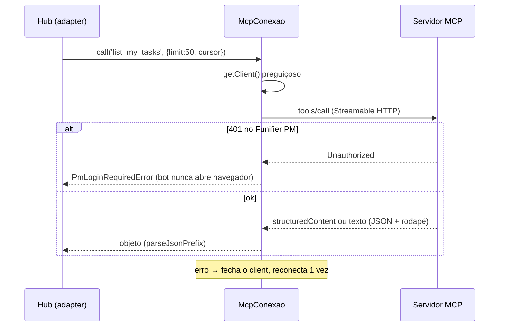

- **Funifier PM:** OAuth 2.1 + PKCE com registro dinâmico. Os tokens ficam em `data/oauth/funifier-pm.json` (600) e o SDK renova com `refresh_token`. O login interativo é só pelo `npm run pm:login`. (A variável `FUNIFIER_PM_TOKEN` do `.env` não é usada.)
- **Bnexo:** `Authorization: Bearer $BNEXO_MCP_TOKEN`.
- **Travas de escrita:** `setStatus` passa por `escritaPermitida(env, taskId)` (`HUB_ESCRITA_PM`, `HUB_ESCRITA_PM_SOMENTE`); comentário passa por `HUB_COMENTARIOS_PM`. Bloqueado vira `EscritaBloqueadaError`, que o despacho mostra como aviso sem quebrar o fluxo.
- Mapeamento de tools e status: [referência dos MCPs](../referencia/mcp-ferramentas-de-gestao.md).

### 5.3 Orca e Claude Code

O hub nunca fala com o Claude Code diretamente: **digita no terminal** e **lê a tela** pelo Orca.

| Operação | Comando | Onde |
|---|---|---|
| Achar sessões da pasta | `orca terminal list --worktree path:<pasta>` + filtro `agentIdentity=claude` e `writable` | `sessoesClaude` |
| Estado do agente | `orca worktree ps` → mapa `tabId:leafId → working\|done` | `agentStates` |
| Ler a tela | `orca terminal read --terminal <h> --screen --limit 60` | `readScreen` |
| Esperar ociosidade | `orca terminal wait --for tui-idle --timeout-ms 60000` | `waitIdle` |
| Mandar a task | `orca terminal send --text "Leia e execute a task descrita em <arquivo>." --enter` | `send` (recusa `\n`) |
| Abrir sessão | `orca terminal create --command "claude [-c\|--resume id] --permission-mode auto"` | `abrirSessao` (comando validado por regex) |
| Fechamento | `orca worktree set --workspace-status in-review --comment …` | `concluir` |

Todos os comandos usam `execFile(bin, [...args, '--json'])`, e a resposta `{ok,result,error}` vira `OrcaError`. **Os handles mudam quando o Orca reinicia:** o despacho guarda o handle, mas quando falha redescobre pela pasta (e, com várias sessões, procura na tela `runs/<id>.md` ou `task: #<tag>`). Depois de 3 falhas seguidas, a task fica `interrompida`.

**Classificação da tela** (`classificarTela`, olhando só as 14 últimas linhas não vazias):

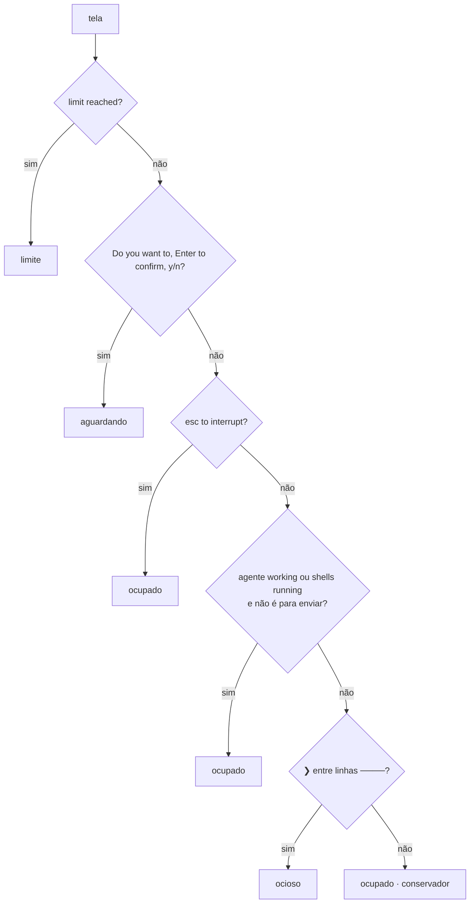

`paraEnviar=true` ignora shell em segundo plano (um servidor de dev não impede mandar mensagem). No acompanhamento o shell conta, **exceto** quando o `RESULTADO HUB` da rodada já está na tela (B18).

---

## 6. Ciclo de vida de uma task

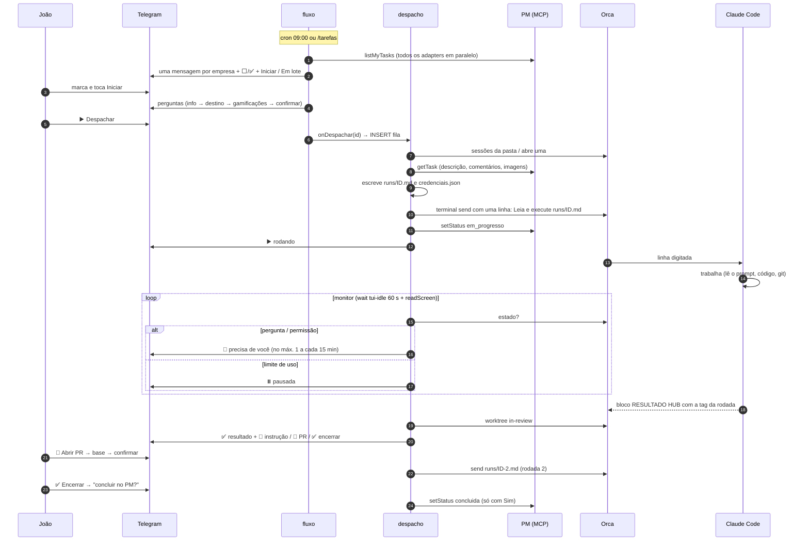

### Protocolo hub ↔ sessão

1. **Ida:** o prompt completo fica em `runs/<id>.md` (rodadas seguintes: `runs/<id>-<n>.md`). Ao terminal vai uma linha só, o que evita quebra de linha, colagem e injeção no shell.
2. **Volta:** o prompt exige terminar com um bloco fixo, que o hub lê da tela com `extrairResultado`:
   ```
   ### RESULTADO HUB
   task: #12.2
   status: concluido | bloqueado | precisa_revisao
   resumo / arquivos / branch / pendencias
   ```
   O hub procura o **último** bloco da tela, junta as linhas quebradas pelo terminal e só aceita se a `task:` bater com a tag da rodada (`tagRodada`). Assim, o bloco de uma rodada anterior ainda visível não fecha a rodada nova.
3. **Lote:** a líder gera um `runs/<id>.md` com uma seção por task e um único bloco de resultado. As outras seleções têm `lote_de = <líder>` e acompanham o estado dela.

---

## 7. Estado e banco

### 7.1 Máquinas de estado

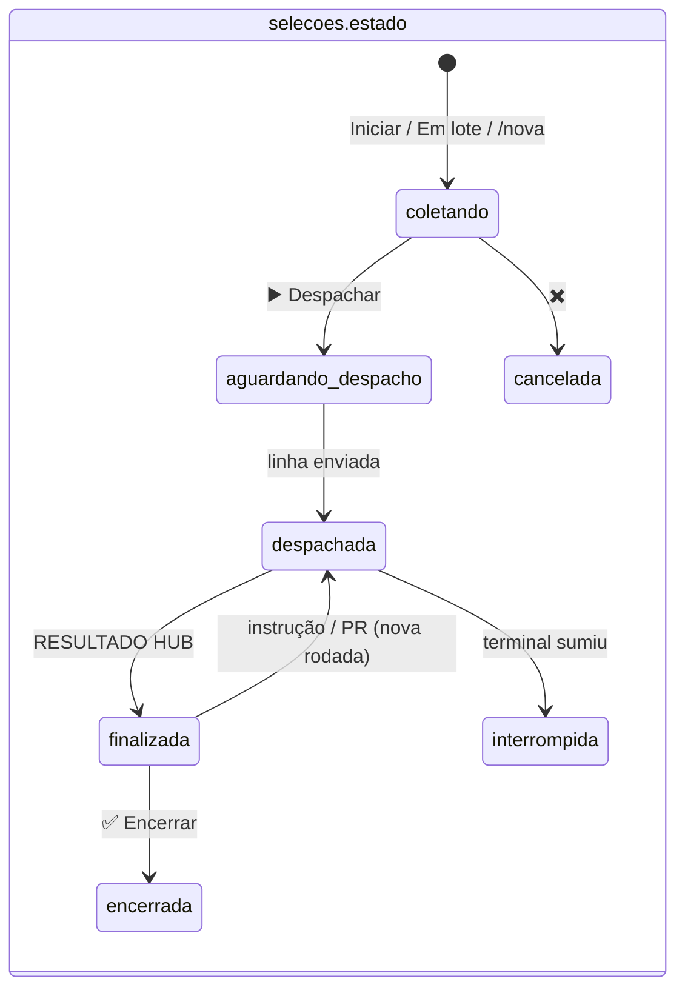

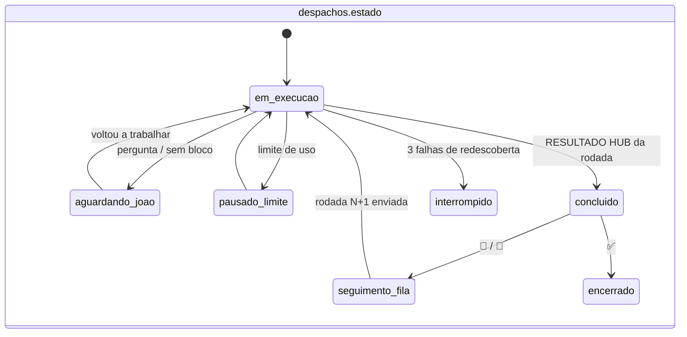

A etapa da conversa (`selecoes.etapa`) é uma terceira máquina, interna ao `coletando`: `instrucoes → info → empresa → destino → ambiente/amb_* → escolher_app → alvo → confirmar`. Cada transição é um `UPDATE` seguido de `proximaPergunta()`, que **renderiza a pergunta a partir do estado salvo**. Por isso um restart no meio da conversa não perde nada.

### 7.2 Esquema

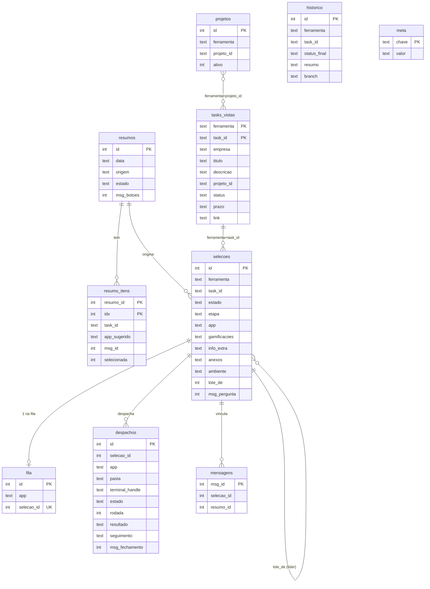

- **Migrações:** um array de SQL em `db.ts`; `PRAGMA user_version` diz quantas já rodaram, e cada uma roda numa transação. Hoje são 8 (a 8 é o lote). Nunca se edita uma migração antiga: sempre se acrescenta uma nova.
- **`meta`:** chave-valor para estados soltos: `resumo_diario_data` (idempotência do resumo), `pos_conversa`, `regras_conversa`, `gamif_conversa`.
- **JSON em colunas:** `gamificacoes`, `anexos`, `ambiente`, `resultado`, `seguimento`. São lidos e escritos inteiros, sem consulta por dentro.

### 7.3 Arquivos fora do banco

| Caminho | Conteúdo | Git |
|---|---|---|
| `apps.yaml` | Catálogo app → pasta → projetos → gamificações (ids de credencial) | sim |
| `regras/<empresa>.md` | Regras de trabalho incluídas em todo prompt | sim |
| `runs/<id>.md`, `runs/<id>-<n>.md`, `runs/<id>/` | Prompts, imagens, anexos, `credenciais.json` (600) | não |
| `data/hub.db` | Banco | não |
| `data/oauth/`, `data/segredos/` | Tokens OAuth do PM, cofre de gamificações (600) | não |
| `data/apps-historico/`, `data/regras-historico/` | Backup antes de cada edição feita pelo bot | não |
| `logs/hub-AAAA-MM-DD.log` | JSON por linha, com segredos redigidos | não |

---

## 8. Concorrência e tempo

Um processo, um event loop, sem workers. O que roda "ao mesmo tempo":

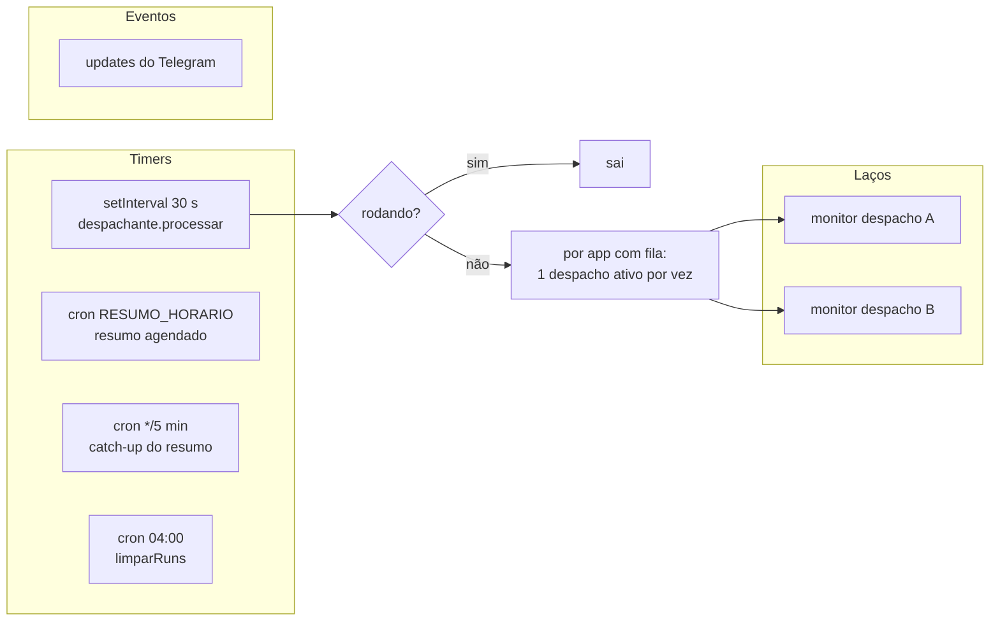

- **`processar()`** tem trava de reentrância (`rodando`). Cada app tem no máximo **um despacho ativo**; continuações (`seguimento_fila`) passam na frente da fila nova, porque a sessão ainda tem o contexto.
- **Monitores:** um laço `async` por despacho, disparado com `void` e protegido por um `Set` (`monitorados`). Ao iniciar, `retomarMonitores()` recria os laços dos despachos ativos no banco, então um restart não perde acompanhamento.
- **Resumo:** o agendado e o catch-up são idempotentes por dia (`meta.resumo_diario_data`), e a flag `enviandoResumo` evita duplicar.
- **better-sqlite3 é síncrono:** cada `prepare().run()` é atômico no event loop. Operações compostas usam `db.transaction()`.
- **AsyncLocalStorage** (`mensagens.ts`): cada update e cada laço roda num contexto `{selecaoId, resumoId}`. O transformer da API do grammY registra toda mensagem enviada com esse vínculo, sem passar parâmetro por todas as funções.

---

## 9. Segurança

| Risco | Defesa | Onde |
|---|---|---|
| Outra pessoa comandar o bot | Primeiro middleware descarta qualquer chat ≠ `TELEGRAM_CHAT_ID` e registra em log | `telegram.ts` |
| Texto de task virar comando | `execFile` com array; `send` recusa `\n`; o prompt vai em arquivo; o comando de abrir sessão é validado por regex | `orca.ts`, `despacho.ts` |
| Nome ou URL maliciosos no ambiente novo | Nome `^[a-z0-9][a-z0-9._-]{1,59}$`; URL de git validada e sem `-` no início; `git clone --`; `GIT_TERMINAL_PROMPT=0` | `fluxo.ts` |
| Vazamento de segredo em log | `redact()` troca valores de variáveis `*TOKEN*\|*SECRET*\|*KEY*` e padrões conhecidos | `logger.ts` |
| Credenciais de gamificação | Cofre 600; a mensagem no Telegram é apagada; a task só recebe as autorizadas; o prompt proíbe copiar | `segredos.ts`, `gamificacoes.ts`, `prompt.ts` |
| Mexer em task real por engano | Travas `HUB_ESCRITA_PM`, `HUB_ESCRITA_PM_SOMENTE`, `HUB_COMENTARIOS_PM`; "concluída" só com Sim no Encerrar | `pm/types.ts`, `despacho.ts` |
| Sessão do Claude sem freio | `--permission-mode auto`; `bypassPermissions` fora do enum do zod | `config.ts` |
| `.env` ou `apps.yaml` inválidos | zod falha na inicialização; edições pelo bot validam antes de gravar e guardam backup | `config.ts` |

---

## 10. Limitações conhecidas (insumo para a v2)

- **Leitura de tela é heurística:** depende do texto do TUI do Claude Code (`esc to interrupt`, `❯`, `────`). Uma mudança de versão do Claude Code pode exigir ajuste em `classificarTela`/`extrairResultado`.
- **Texto digitado e não enviado** na caixa da sessão recebe a linha do hub anexada; não dá para distinguir de uma sugestão do Claude Code.
- **Dois arquivos grandes** (`fluxo.ts`, `despacho.ts`) concentram muita lógica. Na v2 vale separá-los por assunto (conversa, ambiente, lote; envio, monitor, próximos passos).
- **Coisas pessoais no código** (empresas fixas, pastas, servidores, textos com "João"): ver o inventário em [v2 · app universal](../v2/app-universal.md#b4-inventário-o-que-é-pessoal-na-v1).
- **Sem testes automatizados:** a validação foi manual e por scripts. A v2 deve começar com testes de `classificarTela`, `extrairResultado`, prompts e as máquinas de estado.
